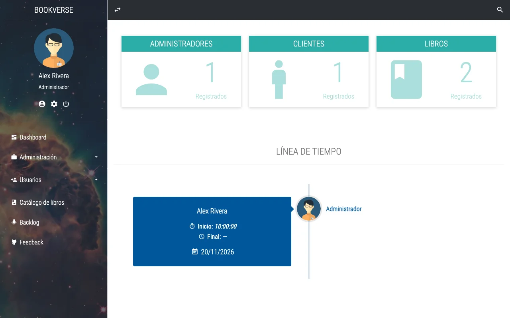

<p align="center"></p>

# Bookverse

Biblioteca educativa en español y proyecto donde nació la marca Bookverse.

[English](README.md) · [Abrir la biblioteca](https://moncada25.github.io/Bookverse/) · [](https://github.com/Moncada25/Bookverse/actions/workflows/pr-checks.yml)



## El origen de Bookverse

Santiago Moncada publicó Bookverse el 18 de junio de 2019. Fue uno de sus primeros proyectos públicos en GitHub. Con PHP y MySQL construyó una biblioteca donde los lectores podían encontrar material educativo y los administradores podían organizarlo. En 2020 llegaron la página de feedback y el backlog de tareas. El nombre de aquella biblioteca dio origen a la marca Bookverse. [Primer commit](https://github.com/Moncada25/Bookverse/commit/77ac5c1) · [Explorar la edición PHP](https://github.com/Moncada25/Bookverse/tree/ce5734c)

La edición en Astro recupera el fondo lunar del login, la tipografía Roboto Condensed, los iconos Material y el dashboard. GitHub Pages sirve las pantallas y cada navegador conserva su propia biblioteca.

## Probar la demo

Elige **Administrador** o **Lector** en el login. Si prefieres escribir las credenciales de ejemplo, usa `admin` o `lector` con la contraseña `Bookverse2019`. Como administrador podrás agregar libros, gestionar categorías y usuarios y consultar la línea de tiempo. Como lector podrás filtrar el catálogo, leer PDF y organizar tus tareas.

Los registros, archivos y cambios se guardan en IndexedDB. La sesión pertenece a la pestaña. Usa datos ficticios para los perfiles. Si borras el almacenamiento del sitio, la siguiente visita restaurará el catálogo de muestra. La pantalla de feedback prepara un issue en GitHub para que puedas revisarlo y enviarlo.

## Desarrollo local

Con Node.js 24.22.2 y npm instalados:

```sh
gh repo clone Moncada25/Bookverse
cd Bookverse
npm ci
npm run dev
```

Abre la dirección que imprime Astro bajo `/Bookverse/`. Usa `npm run check` para verificar Astro y TypeScript, `npm run build` para generar el sitio en `dist/` y `npm run preview` para probarlo. Después del build, ejecuta `npx playwright install chromium` y `npm test` para correr las pruebas de navegador.

## Contribuir

Las páginas están en `src/pages/`, la navegación compartida en `src/components/` y la lógica del navegador y los datos en `src/client/`. El tema histórico y los libros de ejemplo están en `public/`.

Para reportar un error, indica la pantalla, el navegador y los pasos para reproducirlo. En un PR describe el cambio, ejecuta las pruebas y adjunta capturas en escritorio y móvil si modificaste una pantalla. Los checks obligatorios son **validate** y **gitleaks**. Al fusionar el PR a `main`, GitHub Actions compila y publica el sitio en Pages.

El código propio y los cuadernos originales de muestra tienen [licencia MIT](LICENSE). Los recursos visuales históricos se documentan en los [créditos](docs/credits.md).
