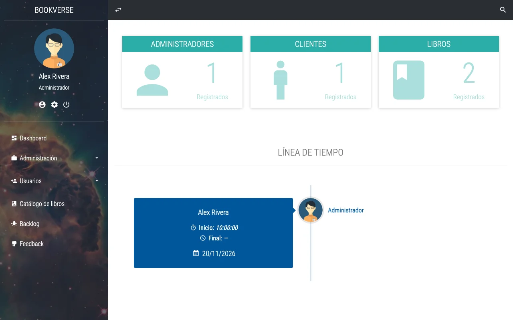

<p align="center"></p>

# Bookverse

A Spanish-language educational library and the project where the Bookverse brand began.

[Español](README.es.md) · [Open the library](https://moncada25.github.io/Bookverse/) · [](https://github.com/Moncada25/Bookverse/actions/workflows/pr-checks.yml)



## Where it started

Santiago Moncada published Bookverse on June 18, 2019. One of his first public GitHub projects, it was a PHP and MySQL library where readers could find educational books and administrators could organize them. A community feedback page and a task backlog followed in 2020. The name outlived the original application and became the Bookverse brand. [First commit](https://github.com/Moncada25/Bookverse/commit/77ac5c1) · [Explore the PHP edition](https://github.com/Moncada25/Bookverse/tree/ce5734c)

The Astro edition keeps the Spanish screens, lunar login background, Roboto Condensed typography, Material icons and dashboard. GitHub Pages serves the application. Each browser holds its own copy of the library.

## Explore the demo

Choose **Administrador** or **Lector** on the login screen. To type the example credentials yourself, use `admin` or `lector` with `Bookverse2019`. The administrator can add books, manage users and categories, and see the activity timeline. Readers can filter the catalog, read PDFs and track tasks.

Local signups, file uploads and edits persist in IndexedDB for this site. The active session lives in the tab. Use fictional profile details. Clearing the site's storage restores the sample library on your next visit. Feedback opens an issue draft on GitHub for you to review.

## Run locally

With Node.js 24.22.2 and npm installed:

```sh
gh repo clone Moncada25/Bookverse
cd Bookverse
npm ci
npm run dev
```

Open the printed URL under `/Bookverse/`. Run `npm run check` for Astro and TypeScript diagnostics, `npm run build` for the static site in `dist/`, and `npm run preview` to serve that build. After building, run `npx playwright install chromium` and `npm test` for the browser tests.

## Contribute

The Astro pages are in `src/pages/`, shared navigation in `src/components/`, and browser behavior and storage in `src/client/`. The historical theme and the example books are served from `public/`.

Open an issue with the screen, browser and steps to reproduce a problem. For a pull request, describe the change, run the checks and include desktop and mobile screenshots when a screen changes. Required checks are **validate** and **gitleaks**. Merging to `main` builds and deploys the site to Pages.

Bookverse code and original sample texts use the [MIT license](LICENSE). The historical visual assets have their own [attribution notes](docs/credits.md).
